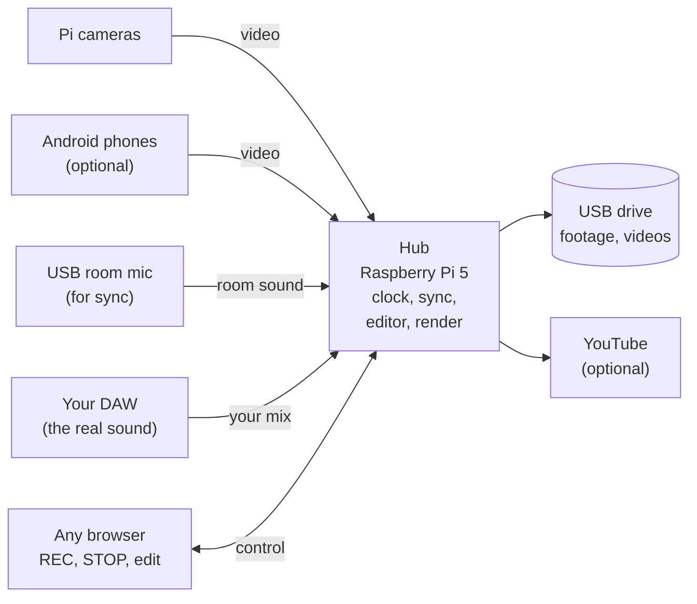
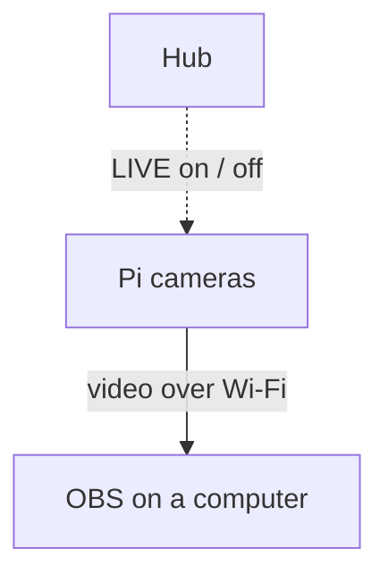
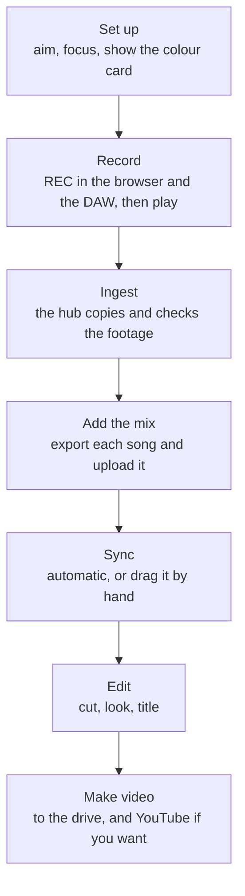
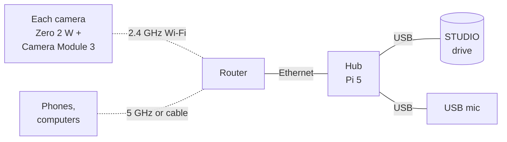

# Studio Multicam

**Press REC, play music, get a multi-camera music video.**

Studio Multicam turns Raspberry Pi cameras and Android phones into a synchronised video rig for a home music studio. A Raspberry Pi 5, the *hub*, runs everything from a web page: it records every camera, collects the footage, lines up your studio mix, gives you a multicam editor in the browser, and renders the finished video. It can also send that video to YouTube as a private upload.

There is no app to install and no cloud service in the middle. You record your sound as usual in your DAW (Logic, Reaper, Ableton and so on); this system does the pictures.

> [!NOTE]
> **Version 1.0: the project is finished.** It was built for one studio and is shared in case it's useful. It is not a packaged product: setting it up takes some Linux, SSH and Ansible. See [Status and limits](#status-and-limits).

**Contents:** [How it works](#how-it-works) · [Workflow](#the-workflow) · [What you need](#what-you-need) · [Assembly](#assembly) · [Installation](#installation) · [Security](#security) · [Status and limits](#status-and-limits) · [Find your way around](#find-your-way-around) · [License](#license)

## How it works



- **The cameras only capture.** Each Pi camera records 1080p30 to its own SD card, kept in step with the others by Raspberry Pi's software camera sync.
- **The hub does the rest.** It is the remote control, the clock every camera follows, the file server, the editor and the render machine.
- **The sound comes from your DAW.** The cameras record no audio. The hub's USB mic records a rough track of the room, used only to work out where your mix belongs on the video.
- **The drive keeps the results.** Footage, mixes, edits and finished videos live in one folder per take on an ordinary USB drive.

There are two ways to use the cameras, one at a time:

| | **Take** (the main one) | **LIVE** |
|---|---|---|
| For | Recording music videos | Live streams and shows |
| Cameras | Pi cameras and Android phones | Pi cameras only |
| Video is recorded | On each camera, then moved to the drive | By [OBS](https://obsproject.com/) on your computer, if you want it |
| Picture quality | About 16 Mbps per camera | About 5 Mbps per camera |
| Goes through the hub | Yes, for editing | No, OBS connects to each camera |



## The workflow



Everything below happens at **http://studio-hub.local/**. The page has four views: **deck** (REC, STOP, LIVE), **monitor** (health of each device), **cameras** (pictures and focus) and **archive** (takes, songs and videos).

1. **Set up.** In *cameras*, check the framing and save each Pi camera's focus. With the page open, show each Pi camera the printed [calibration card](hub/calib/calibration-card.pdf); it sets exposure and colour and chimes when done. Both stay fixed during a take. For a phone, scan the QR code under *use a phone as a camera*; it sets its own exposure and colour, so it doesn't need the card.
2. **Record.** Start recording in your DAW, press **REC** on the deck, and clap once in view of the cameras as a fallback for syncing by hand. Play as many songs as you like, with the music audible to the hub's mic. Press **STOP** at the end.
3. **Ingest.** Leave everything powered and the drive plugged in. After 30 minutes idle, or when you press **ingest now** in the archive, the hub copies each camera's video to the drive and checks it. Only then does the camera delete its own copy.
4. **Add the mix.** Export each song from the DAW (a *bounce*) and upload it with **add a bounce** on the take. WAV, AIFF, FLAC, MP3 and M4A work. A newer mix of the same song becomes a new version.
5. **Sync.** The hub finds the song in the room recording and lines it up. If it isn't sure, it says **needs sync**, and you drag the mix into place in the editor.
6. **Edit.** Press **edit video**. The editor has three steps:
   - **Cut:** start from an automatic cut on the beat, then choose which camera shows when.
   - **Look:** one filter and any effects for the whole song.
   - **Title:** an opening title, the players' names, and where the video starts and ends.
7. **Make video.** The hub renders a 1080p30 file with your mix as the soundtrack and writes it to the drive. Rendering can take several times the length of the song. With YouTube set up, it then uploads the video as **private**, for you to check and publish.

Recording always has priority: ingest, renders and uploads pause during a take or LIVE, and carry on afterwards.

To take the footage elsewhere, press **eject drive** before unplugging. Each take is a normal folder:

```text
STUDIO/takes/2026-11-21_20261121-184414/
├── take.json              what was recorded, timing, dropped frames
├── cam1.mov               one file per camera, all on the same timecode
├── cam2.mov
├── phone-k7q2.mov
├── audio/                 the room recording and your bounces
└── edits/                 saved cuts and finished videos, per song
```

> [!WARNING]
> After ingest the drive holds the only copy of the camera footage. Back it up.

## What you need

### Core kit

| Qty | Part | Notes |
|---|---|---|
| 1 | **Raspberry Pi 5** | The hub. The original has 1 GB of RAM, which works. |
| 1 | **Active cooler** for the Pi 5 | Rendering works it hard. |
| 1 | **Official 27 W USB-C supply** for the Pi 5, or an equally solid one | A weak supply crashed the original hub during renders. |
| 1 | **microSD card, 128 GB** for the hub | Holds phone uploads, work in progress and editing previews. |
| 1 | **Ethernet cable** | From the hub to your router. |
| 1 | **USB drive or SSD** | exFAT, labelled `STUDIO`. Allow about 7 GB per camera per hour. Use a powered drive if it draws much current. |
| 1 | **USB microphone** for the hub | For automatic sync. A cheap one is fine. Without one you sync by hand. |

### For each Pi camera (the original rig has four)

| Qty | Part | Notes |
|---|---|---|
| 1 | **Raspberry Pi Zero 2 W** | The original Zero and Zero W are not suitable. No header pins needed. |
| 1 | **Raspberry Pi Camera Module 3 Wide** | The only camera this has been tested with. |
| 1 | **Pi Zero camera cable** | Narrow 22-pin end for the Zero, wide 15-pin end for the camera. The standard 15-to-15-pin cable does not fit. |
| 1 | **microSD card, 32 GB or larger**, high-endurance | 32 GB holds about 3.5 hours. |
| 1 | **5 V 2.5 A micro-USB supply** | One per camera. Don't share the hub's. |
| 1 | **Heatsink** | Helps on long takes. |
| 1 | **Case or bracket, and a fixed mount** | Any that holds the camera upright and still. |

### Also needed

- **A router** with 2.4 GHz Wi-Fi for the Pi cameras (ideally a quiet channel of their own) and 5 GHz for phones and computers, all on one network. It must pass broadcast and multicast traffic, with client isolation off.
- **A computer to install from.** A Mac is what has been tested.
- **A computer with Chrome** for editing.
- **Your normal audio setup:** DAW, interface, microphones.
- **A colour printer and matte paper** for the calibration card.

### Optional

- **Android phones with Chrome** as extra cameras (tested: Pixel 3, 3a and 9a), each with a mount and charger. iPhones don't work.
- **An RGB smart bulb** running Tasmota or ESPHome, as a recording light.
- **A computer with OBS** for LIVE.
- **A YouTube channel** and a free Google Cloud project for uploads.

## Assembly

No soldering and no custom parts. Assemble with the power off. Every Pi has its own power supply.

### How it connects



### Build each camera

1. Stick the heatsink on the Zero 2 W's main chip.
2. Lift the latch on the Zero's camera connector gently, as it breaks easily. Slide in the **narrow** end of the cable with the metal contacts facing the circuit board, and close the latch.
3. Fit the **wide** end into the Camera Module 3 the same way, contacts facing its circuit board.
4. Fit both boards into the case or bracket.
5. Insert the microSD card once it has been flashed (see [Installation](#installation)).
6. Connect power to the micro-USB port marked **PWR IN**, not the one marked USB.

### Build the hub

1. Fit the active cooler and plug its lead into the Pi 5's fan connector.
2. Insert the flashed microSD card.
3. Connect Ethernet to the router.
4. Plug the `STUDIO` drive into a blue USB 3 port and the microphone into any other USB port.
5. Connect the power supply last.

### Place everything

- **Cameras:** fixed, and **the right way up**, because the software doesn't rotate the picture. Check on the *cameras* view before fixing one permanently, and keep mic stands out of the edges of the wide lens.
- **Wi-Fi:** aim for −60 dBm or better at every camera (the *monitor* view shows it). Weak Wi-Fi is the most common cause of trouble.
- **Hub microphone:** somewhere it hears the music. If everyone is on headphones and direct inputs it hears nothing, and you sync by hand.
- **Lighting:** plenty of it, and steady. The camera sensors are small.
- **Recording light:** out of shot, so it doesn't tint the picture.

The [runbook](docs/runbook.md) has a checklist for mounting a camera.

## Installation

The Pis are set up from your computer with Ansible. In outline:

1. **Flash** Raspberry Pi OS Lite (64-bit, trixie) onto each card, with hostnames `studio-hub` and `cam1`, `cam2` and so on, the user `studio`, and your SSH key.
2. **Format** the USB drive as exFAT with the name `STUDIO`.
3. **Adapt the config** to your studio: camera list, network range, time zone, mains frequency, and the recording light.
4. **Run the playbooks:** `bootstrap.yml` once, then `site.yml`.
5. **Print** the [calibration card](hub/calib/calibration-card.pdf) on A4 landscape at 100% and glue it to something flat.
6. **Open** http://studio-hub.local/ and record a short test take.

**Follow [deploy/README.md](deploy/README.md) for the commands.** Don't skip step 3: the settings in this repo are the original studio's.

Some things need a one-off step of their own:

| For | What to do |
|---|---|
| Phones as cameras | A Chrome setting on each phone: [runbook](docs/runbook.md#phone-as-a-camera-offline-takes) |
| Full-quality video in the editor | The same Chrome setting on the editing computer: [runbook](docs/runbook.md#editor-full-video) |
| LIVE in OBS | Add each camera as a media source: [runbook](docs/runbook.md#obs-live) |
| Recording light | Join the bulb to Wi-Fi and set its address: [runbook](docs/runbook.md#recording-light-smart-bulb) |
| YouTube | A one-time sign-in: [YouTube setup](docs/youtube-plan.md#setting-it-up-once-about-15-minutes) |

## Security

**Run this only on a home network you trust. Never forward its ports or put it on the internet.**

- The web page, the APIs and the camera streams have no password and no encryption. Anyone on the network can watch, record and delete takes.
- The hub and cameras refuse commands sent by other websites in your browser. That is no substitute for a login: anything else on the network can still send them. Open the hub by its `.local` name or IP address, as other names are refused.
- The installer gives the `studio` user passwordless sudo on every Pi.
- The Chrome setting for phones and editing tells that browser to treat the hub's plain HTTP address as secure. Set it for that address only.
- If you use YouTube, an upload-only login is stored on the hub.

## Status and limits

| Part | State |
|---|---|
| Synchronised takes, LIVE, ingest to the drive | Working, tested on four Pi cameras |
| Phones as cameras | Working on the Pixels listed above |
| Calibration, focus page, recording light | Working |
| Editor and render | Working |
| Automatic audio sync | Built and accurate on a test take; not proven on a full-band session |
| Automatic cut | Built, using simple rules; not judged on a full-band session |
| YouTube upload | Built; see the [setup and limits](docs/youtube-plan.md) |

Limits to know about before you buy anything:

- **1080p30 maximum.** That is the Zero 2 W's encoder limit.
- **One to four Pi cameras tested.** It is designed for up to six, which hasn't been tried. At least one Pi camera is needed, as phones can't record on their own.
- **Copying is slow.** The cameras' 2.4 GHz Wi-Fi means a long session can take hours to ingest.
- **Phones match less well.** They use automatic exposure and white balance, and nothing colour-matches them to the Pi cameras.
- **The branding is built in.** The original band's name and logo, "Brockley Live", appear on the hub page, in the title sequence and in the optional border. Changing them means [editing the source](hub/README.md#branding).
- **A fresh install is untested.** The playbooks grew with one rig and have not been run end to end on blank cards.

[Version 1.0](docs/release-1.0.md) lists the known issues, what wasn't verified, and what was deliberately left out.

## Find your way around

| Folder | What's in it |
|---|---|
| [`deploy/`](deploy/README.md) | Installation: Ansible playbooks and the settings to change |
| [`node/`](node/README.md) | Software on each Pi camera |
| [`hub/`](hub/README.md) | Software on the hub: web pages, ingest, sync, editor, render, upload |
| `mac/` | The one-time YouTube sign-in script |
| [`docs/`](docs/README.md) | Runbook, design, test results and project history |

The services are Python 3 using Raspberry Pi OS packages, and the web pages are HTML and JavaScript with no build step. [docs/design.md](docs/design.md) explains why it is built this way, and [CLAUDE.md](CLAUDE.md) records the decisions taken since.

To run the tests on your computer (no Pi needed) you need Python 3 with NumPy and Pillow, plus ffmpeg and Node.js:

```sh
(cd node/camnode && python3 -m unittest discover -s tests)
(cd hub/hubd     && python3 -m unittest discover -s tests)
(cd hub/ingest   && python3 -m unittest discover -s tests)
(cd hub/hubd     && node --test tests/editor/*.test.mjs)
```

## License

Copyright (C) 2026 Manne Ohrstrom.

Studio Multicam is free software under the [GNU General Public License, version 3](LICENSE). It comes with **no warranty**, to the extent the law allows. Bundled and derived third-party work keeps its own license: see [THIRD_PARTY_NOTICES.md](THIRD_PARTY_NOTICES.md).
