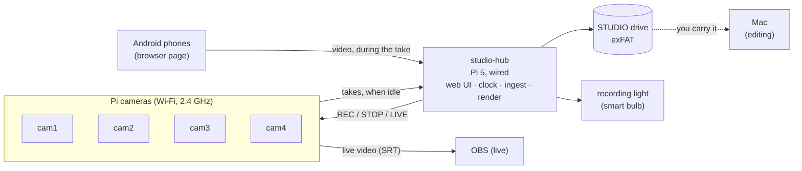

# Studio Multicam

Synchronised multi-camera video for a home music studio, built from cheap Raspberry Pi cameras and the band's own Android phones.

Press **REC** on a web page and every camera starts recording, frame-locked to the others; phones on the hub's phone page join in. The hub collects the footage when the rig is idle and turns it into `.mov` files that share one timecode, on a USB drive. Upload the DAW bounce for a song and the hub can make a finished, YouTube-ready video from it with one button. The same cameras can also stream live into OBS.

## The pieces



| Part | Hardware | What it does |
|---|---|---|
| **Pi cameras** `cam1`–`cam4` (up to `cam6`) | Raspberry Pi Zero 2 W + Camera Module 3 Wide, fixed on the wall | Capture only: 1080p30 with shutter, gain, white balance and focus locked. Either stream live or record takes to SD. |
| **Phones** | Android phones with Chrome | Extra cameras for offline takes, from a web page on the hub (no app). Video uploads to the hub during the take. |
| **Hub** `studio-hub` | Raspberry Pi 5 on Ethernet | Runs the web UI and REC/STOP, serves time to the cameras, calibrates them, copies takes and bounces to the drive, records the room on a USB mic, renders quick-mix videos, and drives the recording light. |
| **`STUDIO` drive** | Portable exFAT drive | Where finished takes, bounces and videos land. You eject it on the hub page and plug it into the Mac. |
| **Mac** | | OBS for live shows; editing in our own editor (planned: `docs/editor-plan.md`). |

## Two modes

- **Live:** each Pi camera streams with [MediaMTX](https://github.com/bluenviron/mediamtx). OBS pulls `srt://camN.local:8890?streamid=read:cam`. The Pis don't record; OBS records the separate camera feeds. Live video never passes through the hub.
- **Offline takes:** the hub starts `rpicam-vid` on every Pi with Raspberry Pi's software camera sync, so frames line up across cameras. Each camera writes raw H.264 plus per-frame timestamps to SD, and a manifest describing the take. Ready phones record at the same time, timed against the hub's clock.

## A day in the studio

1. Open **http://studio-hub.local/** on any device on the home network.
2. **Set up the picture:** with the page open, show each camera the calibration card; it locks exposure and colour on its own ("✓ calibrated"). The snapshot page (`/snap`) shows every camera's picture and helps set focus. Phones: open the phone page (the 📱 button has a QR code), mark them tripod or handheld, and show them the card too.
3. Check every camera card is green, then press **REC**. The page shows how much recording time is left. Clap on camera at the start of each song.
4. Press **STOP**. The page shows a summary: start spread, frame counts and any dropped frames.
5. Leave everything on. After 30 minutes idle the hub ingests by itself, or press **Ingest now**: each camera's take is pulled, copied into a `.mov` with every frame at its real time and the take's time-of-day timecode, verified, and written to `STUDIO/takes/<date>_<take>/`.
6. **Add the bounce:** "♪ Add audio" on the take, one song or several, each with as many versions as you like. Once a song is synced to the take, **"▶ Make video"** renders it (a new camera every 10 s, the bounce as soundtrack, 1080p30) to the drive, and **"▶ Watch video"** plays it.
7. Press **Eject**, move the drive to the Mac.

The cameras delete a take only after the hub has verified its copy, and only when they need the space. The hub never deletes anything from the drive. Step-by-step how-tos are in [`docs/runbook.md`](docs/runbook.md).

## Repository map

| Folder | What's in it |
|---|---|
| [`node/`](node/) | Everything that runs on a Pi camera: the `camnode` agent, MediaMTX config, systemd units, and test scripts from Phase 1. |
| [`hub/`](hub/) | Everything that runs on the hub: `hubd` (control API and web pages), `hub-ingest` (copies to the drive and renders), chrony config, and spike code. |
| [`deploy/`](deploy/) | Ansible playbooks. All installs and updates go through these, run from the Mac. |
| [`docs/`](docs/) | The design, each phase's plan and results, the runbook, pinned versions, and the progress log. |

All the Python uses only the standard library and the Python 3 that comes with Raspberry Pi OS (the hub also uses OpenCV from the OS packages to read the calibration card). There's no build step anywhere. The web pages are plain HTML files.

## Where the project is

- **Phase 1, feasibility:** done. Sync stays within a frame over an hour, and Wi-Fi carries the bandwidth needed.
- **Phase 2, control:** done. REC/STOP/LIVE from the hub, the camera agent, and Ansible provisioning.
- **Phase 3, ingest:** done. Takes go to the drive verified, with a shared timecode, in sync with the studio audio.
- **Phones as cameras:** done. Android phones join offline takes from a web page.
- **Phase 4, in progress:**
  - **Picture (Track B):** built. Calibration by showing a card, the snapshot and focus page, settings applied in LIVE too.
  - **Sound (Track A):** bounce upload with songs and versions, and the hub mic recording, are built; the automatic sync waits for the USB mic. The one-button quick mix (A4) is built and renders on the hub.
  - **Polish (Track C):** the recording light is ready for the bulb; small fixes and the runbook are done.
- **Editor:** planned (`docs/editor-plan.md`). Its spikes passed, and ingest already copies video at its real frame times for it.

[`docs/progress.md`](docs/progress.md) has the details and what's next.

## Getting started as a developer

- **Read first:** [`docs/design.md`](docs/design.md) explains why things are built this way. [`CLAUDE.md`](CLAUDE.md) lists the decisions that are settled.
- **Run the unit tests** (on the Mac; no Pi needed; the render tests need ffmpeg):
  ```sh
  (cd node/camnode && python3 -m unittest discover -s tests)
  (cd hub/hubd     && python3 -m unittest discover -s tests)
  (cd hub/ingest   && python3 -m unittest discover -s tests)
  ```
- **Deploy** with Ansible; see [`deploy/README.md`](deploy/README.md). It refuses to run during a take or live session.
