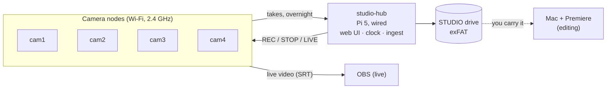

# Studio Multicam

Synchronised multi-camera video for a home music studio, built from cheap Raspberry Pi cameras.

Press **REC** on a web page and every camera starts recording, frame-locked to the others. Overnight the hub collects the footage and turns it into `.mov` files that share one timecode. In the morning you move a USB drive to the Mac, and Premiere lines up all the angles by itself. The same cameras can also stream live into OBS.

## The pieces



| Part | Hardware | What it does |
|---|---|---|
| **Camera nodes** `cam1`–`cam4` (up to `cam6`) | Raspberry Pi Zero 2 W + Camera Module 3 Wide | Capture only: 1080p30 with exposure, white balance and focus locked. Either stream live or record takes to SD. |
| **Hub** `studio-hub` | Raspberry Pi 5 on Ethernet | Runs the web UI and REC/STOP, serves time to the cameras, pulls and converts takes, and writes them to the drive. |
| **`STUDIO` drive** | Portable exFAT drive | Where finished takes land. You eject it on the hub page and plug it into the Mac. |
| **Mac** | | OBS for live shows, Premiere for editing. |

## Two modes

- **Live:** each camera streams with [MediaMTX](https://github.com/bluenviron/mediamtx). OBS pulls `srt://camN.local:8890?streamid=read:cam`. The Pis don't record; OBS records the separate camera feeds. Live video never passes through the hub.
- **Offline takes:** the hub starts `rpicam-vid` on every camera with Raspberry Pi's software camera sync, so frames line up across cameras. Each camera writes raw H.264 plus per-frame timestamps to SD, and a manifest describing the take.

## A day in the studio

1. Open **http://studio-hub.local/** on any device on the home network. On Android, Chrome needs its local-network permission.
2. Check every camera card is green, then press **REC**. Clap once on camera so the studio audio can be lined up.
3. Press **STOP**. The page shows a summary: start spread, frame counts and any dropped frames.
4. Leave everything on. After 30 minutes idle the hub ingests by itself, or press **Ingest now**. Each camera's take is pulled, conformed to exactly 30 fps with time-of-day timecode, verified, and written to `STUDIO/takes/<date>_<take>/`.
5. Press **Eject**, move the drive to the Mac, and in Premiere create a multicam sequence synced by **Timecode**.

The cameras delete a take only after the hub has verified its copy, and only when they need the space. The hub never deletes anything from the drive.

## Repository map

| Folder | What's in it |
|---|---|
| [`node/`](node/) | Everything that runs on a camera: the `camnode` agent, MediaMTX config, systemd units, and test scripts from Phase 1. |
| [`hub/`](hub/) | Everything that runs on the hub: `hubd` (control API and web UI), `hub-ingest` (the overnight worker), and chrony config. |
| [`deploy/`](deploy/) | Ansible playbooks. All installs and updates go through these, run from the Mac. |
| [`docs/`](docs/) | The design, each phase's plan and results, pinned versions, and the progress log. |

All the Python uses only the standard library and the Python 3 that comes with Raspberry Pi OS. There's no build step anywhere. The web UI is a single HTML file.

## Where the project is

- **Phase 1, feasibility:** done. Sync stays within a frame over an hour, and Wi-Fi carries the bandwidth needed.
- **Phase 2, control:** done. REC/STOP/LIVE from the hub, the camera agent, and Ansible provisioning.
- **Phase 3, ingest:** in progress. Built and deployed; acceptance tests are waiting on the `STUDIO` drive.
- **Phase 4, polish:** planned. Image controls, a recording light, audio sync from a hub mic, adding phone video to takes, an automatic edit, and phones as extra cameras.

[`docs/progress.md`](docs/progress.md) has the details and what's next.

## Getting started as a developer

- **Read first:** [`docs/design.md`](docs/design.md) explains why things are built this way. [`CLAUDE.md`](CLAUDE.md) lists the decisions that are settled.
- **Run the unit tests** (on the Mac; no Pi needed):
  ```sh
  (cd node/camnode && python3 -m unittest discover -s tests)
  (cd hub/hubd     && python3 -m unittest discover -s tests)
  (cd hub/ingest   && python3 -m unittest discover -s tests)
  ```
- **Deploy** with Ansible; see [`deploy/README.md`](deploy/README.md). It refuses to run during a take or live session.
